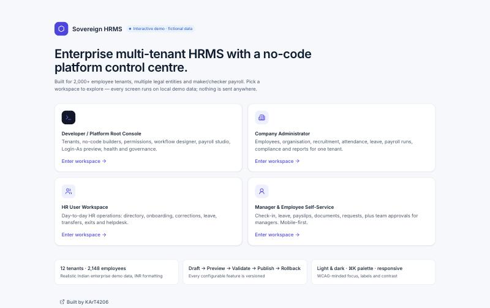
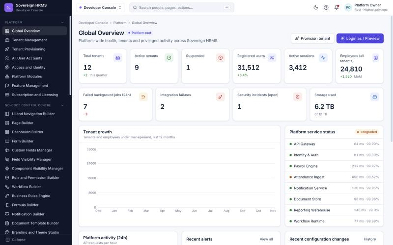
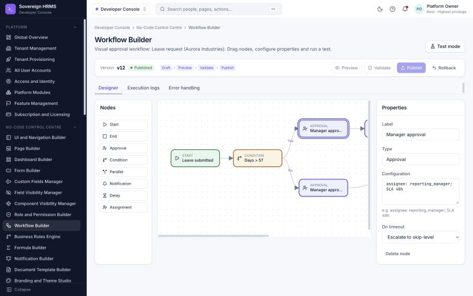
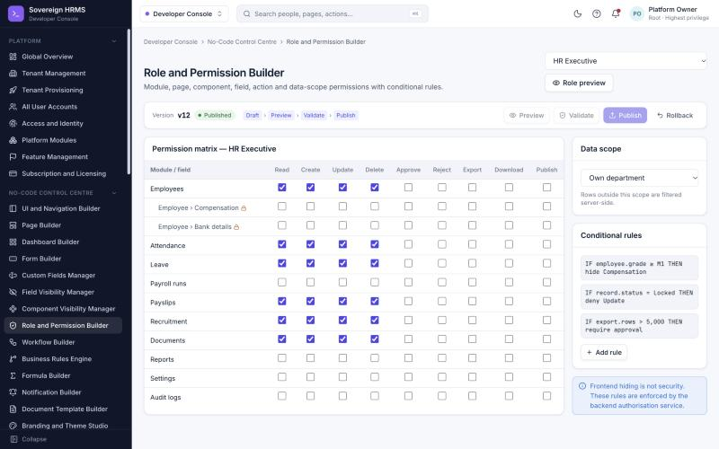
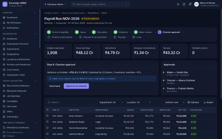
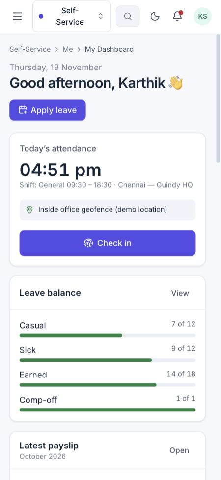

# Sovereign HRMS

> Source code lives in the private repository `Sovereign-HRMS-code`. This repository holds the overview, screenshots and documentation.

**Live interactive demo: https://sovereign-hrms.vercel.app** (fictional data only)

An enterprise, multi-tenant Human Resource Management System frontend built for 2,000+ employee tenants, multiple legal entities and maker/checker payroll — with a no-code Developer Control Centre that governs the whole platform.

## Four workspaces
| Workspace | What it covers |
|---|---|
| **Developer / Platform Root Console** | Global overview, tenant directory + 10-tab tenant detail, 8-step provisioning wizard, global user directory, feature flags, navigation / page / dashboard / form builders, permission matrix, visual workflow designer, IF/AND/OR rules engine, payroll configuration studio, configuration inheritance and version compare/rollback, Login-As preview with audited banner, system health, audit trail, security centre, break-glass recovery |
| **Company Administrator** | Dashboard, 2,148-employee directory, 14-tab employee profile, add-employee wizard, transfer/promotion/salary revision/exit flows, org chart, recruitment kanban, attendance register, leave management, payroll dashboard and a 10-step payroll run (maker → checker → finance → reconcile → payslips → lock), reports, approvals, compliance |
| **HR User** | HR dashboard, directory, onboarding, corrections, leave, documents, recruitment, transfers, exits, helpdesk, announcements, approval tasks |
| **Manager & Employee Self-Service** | Check-in, leave application with validation and approval progress, payslips, attendance, documents, requests; manager team view and approvals. Mobile-first |

## Highlights
- **Draft → Preview → Validate → Publish → Rollback** on every no-code builder, with validation rules (e.g. segregation of duties in the permission builder).
- **Login As / User Preview**: separate actor and target identity, reason and ticket capture, 30-minute countdown, audit reference, persistent red session banner. No passwords, MFA codes or secrets are ever shown.
- **Protected platform-owner identity**: no delete/demote actions, MFA and recovery status, emergency session freeze.
- **Enterprise data tables**: search, multi-filter, sort, column chooser, saved views, bulk actions, CSV export, pagination, mobile card layout.
- **Every module** has empty, loading, error and permission-denied states (switchable from a "State preview" control).
- **⌘K command palette** over pages, employees and actions; light and dark themes; responsive down to phone width.
- **Every module page is tailored**: Table, Board (drag-and-drop kanban), Calendar and Cards views with a sensible default per module (e.g. helpdesk and onboarding open as boards, interviews and holidays as calendars, benefits and courses as cards), live insight panels computed from the module's data, and detail drawers with checklists (onboarding/offboarding), activity and comments.
- Paintable two-week **shift roster** with a night-shift rule check.
- Fast first load: route-level code splitting and tree-shaken icons (~105 KB gzipped initial bundle).
- 163 routes, all rendered and checked for errors.

## Screenshots
| | |
|---|---|
|  |  |
|  |  |

## Architecture
- Navigation is **metadata** (`nav.ts`); the shell filters by workspace and role — pages never hard-code visibility.
- Generic module pages render from a **module registry** (columns, KPIs, filters, create/edit form, approvals); bespoke screens handle the complex workflows.
- Deterministic fictional data generator (Indian enterprise sample data, INR formatting, Chennai / Bengaluru / Mumbai / Delhi / Hyderabad).
- Design tokens as CSS variables with light/dark sets mapped into Tailwind v4.

## Stack
React 19 · TypeScript · Vite · Tailwind CSS v4 · React Router · Recharts · Lucide icons · Vercel

## Limitations
- Frontend prototype: no backend, authentication or persistence. Interface hiding is not security; authorisation belongs on the server.
- No bank files, statutory filings or emails are produced. Payroll figures are illustrative and statutory rates are not hard-coded.
- All people, companies and numbers are fictional.

## Author
Karthik B — [KArT4206](https://github.com/KArT4206)
